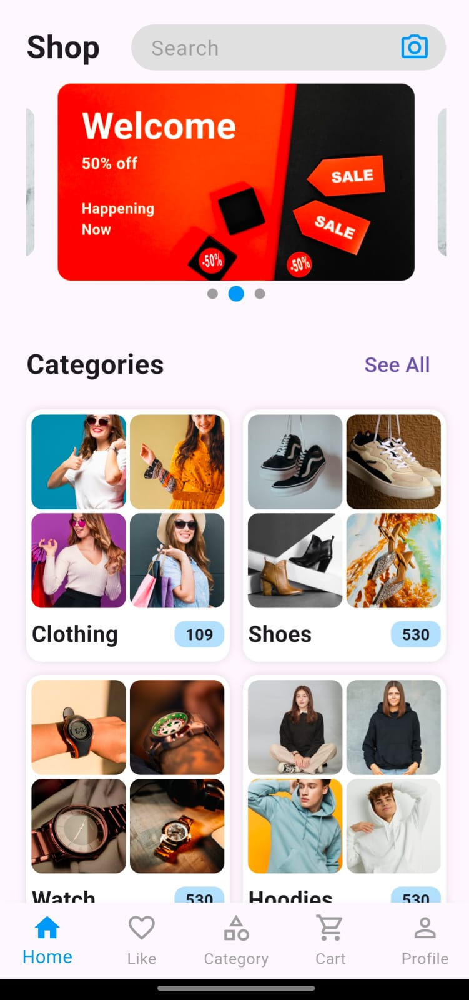
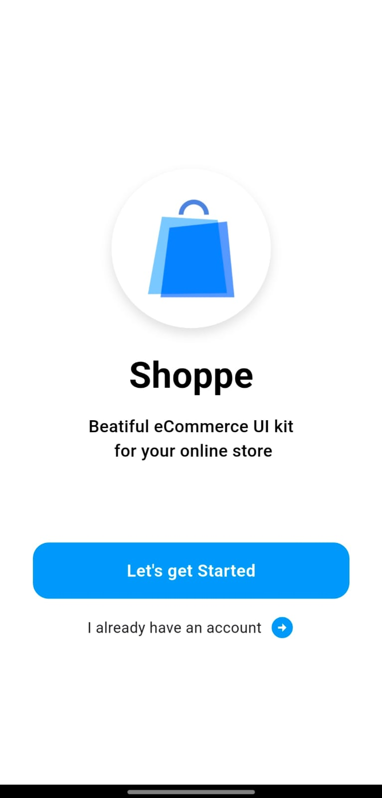
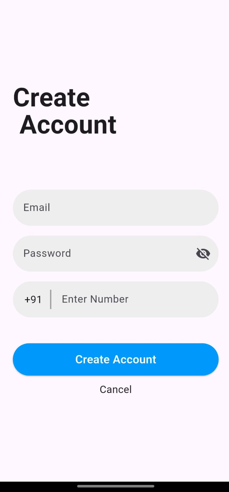

# Shoppe 🛍️

A Flutter-based shopping application project currently in development.

Shoppe is a hands-on project for learning and developing mobile app interfaces and exploring Firebase integration with Flutter.

## 📌 Project Status

**In Progress** — Features and documentation will be updated as development continues.

## 🛠️ Tech Stack

- **Flutter** — Mobile app development
- **Dart** — Programming language
- **Firebase Core** — Firebase integration dependency
- **Firebase Authentication** — Authentication dependency
- **Carousel Slider** — Carousel UI component

*The presence of a dependency does not necessarily mean its functionality is fully implemented.*

## 📂 Project Structure

The project includes the following configured asset directories:

```text
shoppe/
├── android/
├── assets/
│   └── images/
│       ├── Category/
│       ├── home/
│       └── Shop/
│           └── flashsale/
├── lib/
├── test/
├── pubspec.yaml
└── README.md
```

This is an overview of the project structure; individual files and folders may change during development.

## ⚙️ Getting Started

### Prerequisites

- Flutter SDK
- Dart SDK compatible with the project
- Android Studio or VS Code
- Git

### Installation

1. Clone the repository:

   ```bash
   git clone https://github.com/JayeshSuthar02/Shoppe.git
   ```

2. Open the project directory:

   ```bash
   cd Shoppe
   ```

3. Install dependencies:

   ```bash
   flutter pub get
   ```

4. Run the application:

   ```bash
   flutter run
   ```

### Firebase Configuration

Firebase-related packages are included in the project dependencies. Follow the official FlutterFire setup instructions if Firebase configuration is required:

https://firebase.google.com/docs/flutter/setup

Do not commit service-account private keys, passwords, or other sensitive credentials.

## 📸 Screenshots

Screenshots will be added as the application UI develops.


## 📱 App Screenshots

### Home Screen


### Login Screen


### Product Details



Planned work will depend on the project's development progress and may include:

- Refining the shopping app UI
- Integrating and testing Firebase functionality
- Improving loading and error handling
- Documenting implemented features
- Adding screenshots and testing instructions

These are potential improvements, not claims about completed functionality.

## 👨‍💻 Developer

**Jayesh Suthar**

- GitHub: https://github.com/JayeshSuthar02
- LinkedIn: https://www.linkedin.com/in/jayesh-suthar-56525b335/

---

*This project is under active development for learning and portfolio building.*
